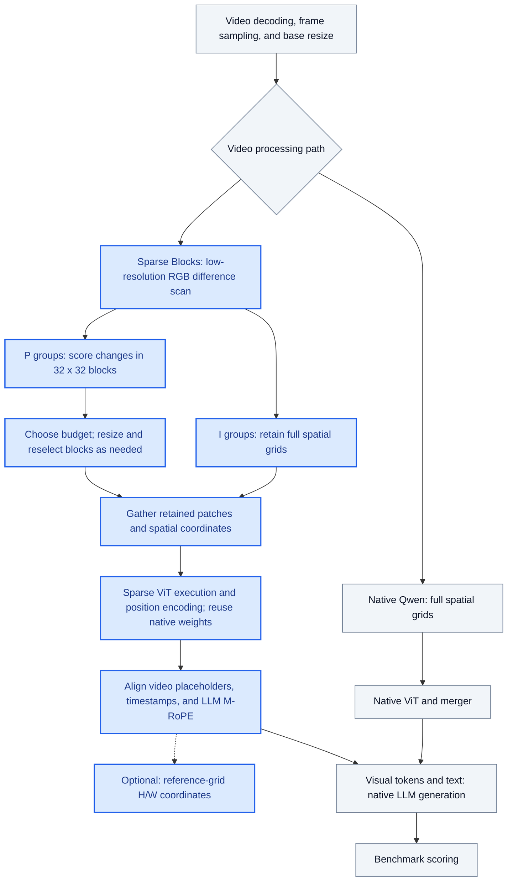

# Sparse Blocks evaluation

This branch adds adaptive pre-ViT RGB block selection to the upstream LMMs-Eval
baseline `d4fd9e67`. It uses native dense Qwen3.5 weights; no separately trained
video encoder or external training repository is required.

## Run

Install the Qwen3.5 evaluation dependencies following the main README, including
a Transformers version that provides Qwen3.5 and the Qwen3VL processor APIs.

```bash
python -m lmms_eval \
  --model qwen3_5_sparse_blocks \
  --model_args pretrained=Qwen/Qwen3.5-9B,max_num_frames=128,do_resize=False,sparse_stats_dir=logs/sparse-stats \
  --tasks videomme --batch_size 1 --limit 8 \
  --output_path logs/sparse-blocks
```

Use a separate statistics directory for each run. JSONL records include the
configuration, selected blocks, frame classification and visual token counts.
`do_resize=False` disables the final native processor resize; adaptive P-frame
budget resizing still runs, after upstream video preparation.

## Pipeline overview

**Blue nodes highlight steps added or adapted by Sparse Blocks.** Gray nodes
show the native Qwen evaluation path and shared components. Processor and model
execution are adapted together; ViT, merger, and LLM weights remain unchanged.



The processor performs frame classification, budget-driven resizing, and block
selection **before patch embedding**. Only retained patches enter the vision
encoder. The model uses their spatial coordinates for vision position encoding
and LLM M-RoPE, while the processor supplies matching video placeholders and
timestamps.

`llm_spatial_grid=resized` (default) uses the final resized grid for LLM spatial
positions. `llm_spatial_grid=reference` maps retained block centers back to the
grid before adaptive P-frame resizing. This option changes the H/W coordinates
of LLM M-RoPE; timestamp construction and the ViT coordinate system are unchanged.

Budgets are resize targets, not strict top-K caps: grid alignment and block
reselection can leave the final token count above the target. When few blocks
change, they can be retained directly; widespread changes use a lower-resolution
full-frame thumbnail.

## Method and controls

Adjacent RGB differences classify I/P frames. I groups keep the full spatial
grid; P groups select changed 32x32 blocks and resize adaptively against a token
budget before the vision encoder. Each selected block produces four 16x16
patches and one merged visual token. Weights remain native Qwen3.5.

- `budgets=16:32:64`, `budget_boundaries=128:512`: adaptive budget tiers.
- `budgets=16`: a single fixed budget tier.
- `rgb_mae_threshold=0.17`, `block_threshold=0.17`: frame/block thresholds.
- `max_consecutive_p_frames=16`: force periodic I frames; `-1` removes the cap.
- `llm_spatial_grid=resized` or `reference`: LLM spatial coordinate system.
- `p_token_ablation=drop`: omit the P branch.
- `i_frame_selection=uniform_equal_count`: uniform I selection using the motion
  classifier's I count. This does not guarantee identical visual token counts.

I groups can pair with the following raw P frame through native temporal pairing,
including when the separate P branch is dropped.

Only batch size 1 and single-beam video generation are supported. This is an
evaluation implementation, not a training integration.

## Scope

The implementation is in `lmms_eval/models/model_utils/sparse_blocks/` and its
`qwen3_5_sparse_blocks` model adapter. Base Qwen integration adds only model setup
and processor-option hooks, plus globally unique distributed ranks for statistics.
Other video compression implementations, experiment-specific scoring changes,
cluster launchers and partial-answer resume machinery are not included.
